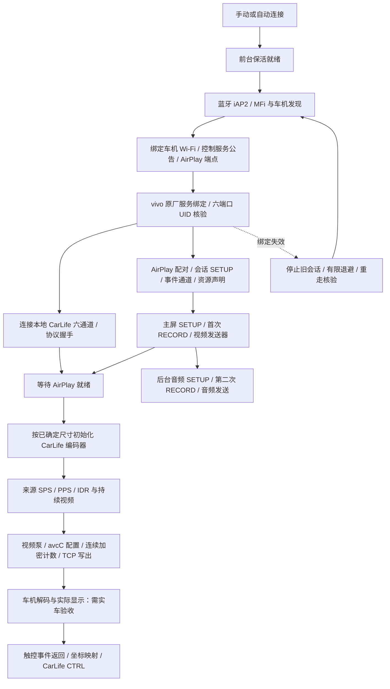

# Hypercar 50006：晚间车测后的恢复与视频链路修复

版本 `0.1.1.6 / 50006`。对应10月28日21点后的50004真机日志：车机可显示Hypercar等待页，来源曾写出759帧，但正常Jovi桌面没有确认，后续来源失效及再次连接失败。本版保留 vivo/Jovi 原厂组件和六端口 UID 核验。

## 修复及行为变化

| 问题 | 新行为 | 验证边界 |
| --- | --- | --- |
| 手动连接跳过保活 | 手动、蓝牙自动和重连统一等待 connectedDevice 前台服务与持锁就绪；失败明确退出 | 服务请求/过期/释放的逻辑回归通过，Android真机后台策略仍需验收 |
| 重连时失去后台启动条件 | 有限重试期间保留已有服务；取消、最终失败或正常断开释放 | 原请求不能停止新请求的保活；不永久持锁 |
| Audi自动连接被BMW名单过滤 | 未选具体MAC时按所选车型匹配；明确MAC始终优先 | Audi、BMW、耳机、无名称设备等回归 |
| 迟到认证应答污染记忆 | 存在未决的旧挑战时不更新当前长度成功/拒绝；链路关闭不推断长度拒绝 | 两个现场时序回放由失败变通过 |
| 旧Audi错误记忆持续使用 | 仅迁移本次日志中 `audi_mmi_4809_audi_3260_delphi` 的旧记录一次；保留已知20B，重试歧义32B；其他车机记忆保留 | 迁移范围和幂等性回归 |
| vivo服务绑定失效后只重拨端口 | 合并失效回调，结束旧会话/旧socket后有限重连，重新绑定和检查六端口UID | 最多3次来源恢复，退避3.1/5/8秒；取消后不再拉起；不强停或禁用vivo |
| 编码器抢先使用旧尺寸 | CarLife在鉴权后等待AirPlay视频就绪，再读取车机尺寸发送编码初始化 | 真TCP握手边界测试，取消可退出等待 |
| 静态画面被0.9秒规则替换为等待页 | 来源健康时保留最后一帧；明确断流才回等待页，恢复须有新的关键帧 | 真视频泵、加密收发、独立H.264解码和像素比对 |
| 虚拟iAP2卡在同步阶段无进度说明 | 记录状态/收发计数/最后接收时间；收到SYN但未完成握手也受20秒上限约束 | 协商超时与原有认证回归；不凭DETECT声称控制会话完成 |
| 系统旧崩溃误归因给应用 | 仅读取本应用最近的平台退出记录并带明确时间；端口拒绝不推断车机关闭原因 | 当前版本静态检查与编译；实际系统原因需后续记录 |

## 手机到车机的实际路径

这是零转码来源转发。CarLife实际可能返回与请求不同的编码尺寸，Hypercar继续使用它回报的实际尺寸，不擅自把SPS改成车机尺寸。来源暂时没有变化不再覆盖最后一帧。编码初始化看门狗从视频会话就绪后计时，避免把等待车机阶段误判成原厂来源超时。

## 本地验证与限制

- 保留会话SETUP、事件通道、视频先行、音频第二次RECORD的上一版修复。
- 执行Android单元测试、Lint、Rust测试与检查、arm64/API31交叉编译、Release压缩打包。
- 使用真实生成的H.264样本，覆盖同尺寸与变尺寸切换、静态暂停、断流和重新出帧；从TCP取出并解密输出，独立FFmpeg解码，与原始样本逐帧像素哈希对照。
- 这是本地回归和模拟对端验证；没有连接手机或车机，没有验证本次vivo画面内容、MIB3解码策略、实际声音/触控和功耗。
- 原厂服务最初为何失效，以及旧实车为什么只看到等待页，不能仅凭本地结果宣布全部定论。新包针对已确认缺陷修复并补齐关键取证，仍需实车复核。

## 真机验收

1. 安装50006，打开日志记录；Shizuku启动并授权，来源为`com.baidu.carlife.vivo`，CarLife联动开启。
2. 车型选Audi MIB3；实验性CarLife优先启动保持关闭。连接车机蓝牙，打开Hypercar连接；车机进入Apple CarPlay。
3. 等待页出现后，确认是否进入Jovi桌面；分别检查点击响应、音乐/导航声音。
4. 主动断开后重新连接一次，记录等待页及正常桌面是否再次出现。
5. 失败后即可断开，导出完整日志。保留车机画面及大致时间，不必一直保持无效连接。

新增取证标记：`keepalive.ready`、`keepalive.retained`、`source.recovery.*`、`IAPLINK: progress`、`VIDEO: config_written`、`PROCESS_EXIT`。配置摘要与帧写出仍不代表接收端已经显示。
