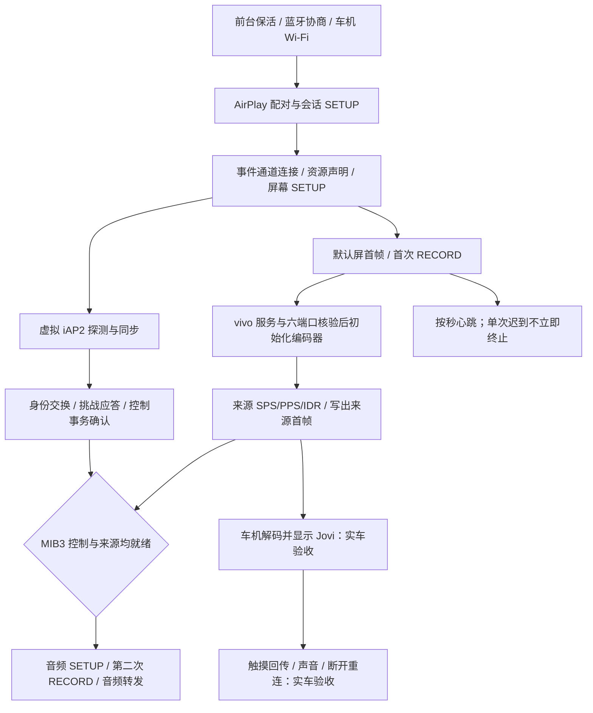

# Hypercar 50007：MIB3 控制握手、音频启动和来源切换

版本 `0.1.1.7 / 50007`。针对 10 月 29 日 50006 车测：默认屏能够显示；开启来源的一轮写出 22 帧，随后首个心跳事务超时使整轮连接结束。此包保留 vivo/Jovi 来源、六端口 UID 检查及已有来源恢复逻辑。

## 修改内容与依据

| 环节 | 旧行为与证据 | 本版行为 |
| --- | --- | --- |
| 控制握手 | 车机连续发探测标记，Hypercar 等 6 秒再主动同步；现场第 4 秒已结束。CarDeck 成功日志在第二次标记后补发同步表 | 完整收到两个探测标记立即补同步表；支持分片/合并输入，已建链与已取消会话不会被重置 |
| 控制发送 | 只确认字节写入，未记录车机是否应答 | iAP2 仍从控制通道发出，按 CarDeck 观察每笔 RTSP 应答；FIFO 队列确保就绪通知在前序控制事务确认后生效 |
| MIB3 音频 | 视频 RECORD 后立即开始音频 SETUP，控制还没有完成同步 | 等控制收到挑战应答、前序控制事务确认及来源首帧写出，再开始音频；最多等待 20 秒，超时跳过本轮音频、保留视频 |
| 心跳 | 等上一笔应答后才发下一笔；单笔等待 3 秒失败就断开整轮 | 首次立即发送，之后每秒发送，最多 3 笔未决；单笔超时继续有限重试，连续 10 秒没有有效心跳应答才结束会话 |
| 默认屏切换 | 视频泵沿用旧设置尺寸，在 1280×720 → 2560×744 → 1280×720 之间切换 | 继续使用已协商发送器的默认屏尺寸，收到实际来源关键帧后再切换；去掉默认屏重复配置 |
| 并发控制事务 | CSeq 分配与排队写入分离 | 分配序号与发出请求保持一致顺序；等待应答时释放写入顺序锁，音频不阻塞心跳 |
| 诊断计数 | 新连接在激活前失败时可能沿用上一轮 22 帧 | 新连接和新原生代次均清零来源帧计数 |
| 码流取证 | 仅记录解码参数哈希及很短前缀 | 记录完整 avcC（SPS/PPS，最多256字节）、配置序号、报告尺寸、编码等级和潜在不一致；不修改原厂码流 |

MIB3 音频等待条件是本车型的兼容策略，不是对所有 AirPlay 接收端增加前置条件。未指定新配置的旧调用方和其他车型保持原来的音频启动方式。

## 连接到出画面的顺序

## 验证覆盖

- 修复前确认失败：重复探测标记未及时引出同步表；已协商默认屏被旧设置尺寸替换；单个迟到心跳阻塞后续心跳发送。
- Android 回归覆盖同步标记分片、合并、已连接和关闭状态，以及挑战应答前后一次性控制就绪通知。
- 使用真实 TCP 对端验证音频两项就绪条件的不同先后顺序、音频等待超时、取消后的迟到就绪、第二次 RECORD、心跳丢失与整体失联上限。
- 保留视频先行、音频拒绝/超时不停止视频、加密序号、事件应答、来源静态画面和断流恢复测试。
- 独立 FFmpeg 解码生产视频泵的 TCP 输出并与合成原始素材逐帧像素比对；不将该结果当作实际 vivo 码流或 MIB3 硬件解码验收。
- 最终测试数量、签名、源码提交与文件哈希见 `docs/artifacts/v50007.json`。

## 未证实的边界

50006 的真实 vivo 来源报告 1280×720、Level 3.0，与本地合成回归素材 Level 3.1 不同。旧日志缺完整 SPS 和来源画面，不能确认是码流参数、解码器切换，还是 Jovi 原厂页面内容造成默认屏未换。50007 补全参数日志，但没有擅自改写 SPS、转码、跳过原厂协议或修改原厂组件。

控制与音频新顺序根据 CarDeck 成功记录和本地状态测试验证，仍需车机复测。车机显示、Jovi 桌面、声音、触控、反复连接和功耗都不以本地测试结果替代。

## 上车测试

1. 安装 50007，确认车型为 Audi MIB3、来源为 `com.baidu.carlife.vivo`、CarLife 联动开启；实验性 CarLife 优先启动保持关闭。
2. 本轮可保持“音频转发”开启，验证新的启动协调逻辑。Shizuku 启动且已授权。
3. 手机连接车机蓝牙/Wi-Fi，打开 Hypercar 建立连接，在车机选择 Apple CarPlay。已提前连接热点也可发起。
4. 默认屏出现后，确认是否切换成 Jovi 桌面；有可操作画面再检查点击、音乐/导航声音和一次主动断开重连。
5. 若仍只有默认屏或连接失败，可直接断开并导出完整日志，记录大致时间和画面；无需长时间保持无效连接。

取证重点：`peer_detect`、`control_command_ack`、`control_ready`、`audio_deferred`、`audio_gate_open` / `audio_skipped`、`feedback_missed`、`codec_parameters`、`first_source_frame_written`。它们都进入应用既有文件日志。
